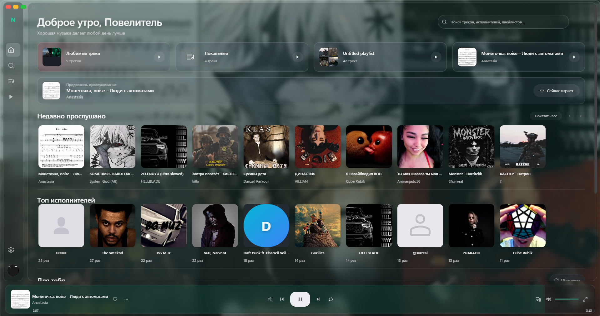
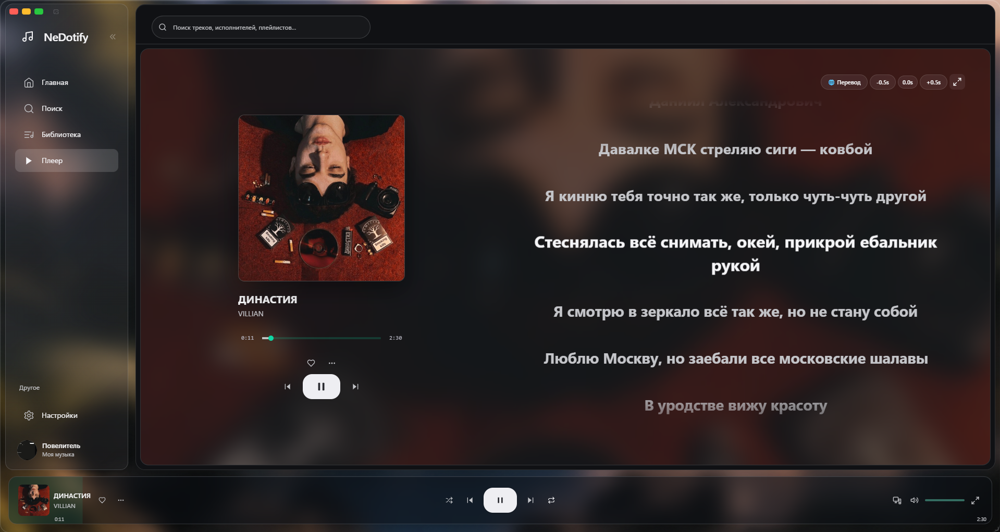
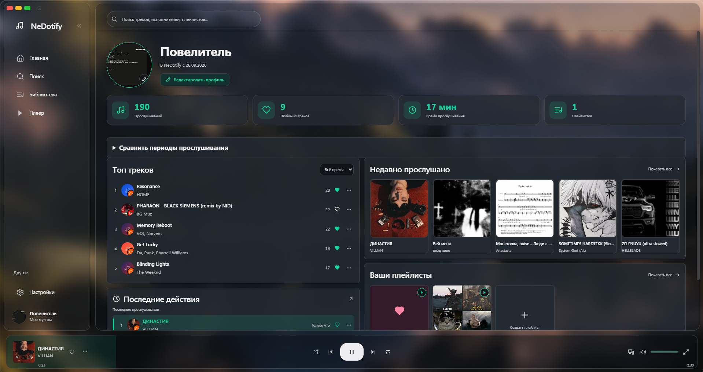

<p align="center">
  
</p>

<p align="center">
  <a href="#установка-windows"></a>
  &nbsp;&nbsp;&nbsp;&nbsp;&nbsp;&nbsp;
  <a href="#установка-linux"></a>
</p>

<p align="center">
  
</p>

<h1 align="center">NeDotify</h1>

<p align="center">
  <b>Кроссплатформенный музыкальный проигрыватель с открытым исходным кодом.</b><br>
  YouTube Music, SoundCloud, VK Музыка, Яндекс Музыка и локальная медиатека.<br>
  Без рекламы, аналитики, телеметрии и обязательной регистрации.
</p>

<p align="center">
  <a href="https://github.com/PoviceProgrammer/NeDotify/releases/latest"></a>
  &nbsp;&nbsp;
  <a href="https://t.me/TequilaVPNbot?start=refugkQUieF"></a>
</p>

<p align="center">
  <a href="#особенности">Особенности</a> •
  <a href="#аудиосистема">Аудиосистема</a> •
  <a href="#интерфейс">Интерфейс</a> •
  <a href="#установка">Установка</a> •
  <a href="#обход-блокировок">Обход блокировок</a> •
  <a href="#сборка">Сборка</a>
</p>

<p align="center">
  
  
  <a href="LICENSE"></a>
  
  
  
</p>

---

## Особенности

### Стриминг и источники
- **Прямой аудиопоток в Chromium**: запуск любого трека за ~0.3 секунды без промежуточной транскодировки.
- **Поддерживаемые платформы**: YouTube Music, SoundCloud, VK Музыка, Яндекс Музыка.
- **Импорт плейлистов**: TikTok, VK Музыка, Spotify, YouTube, локальные списки `.m3u` и `.m3u8`.
- **Локальная медиатека**: воспроизведение FLAC, MP3, AAC, OGG, WAV, Opus. Автоматическое чтение ID3v2/Vorbis тегов и встроенных обложек.

### Воспроизведение и звук
- **Умная предзагрузка очереди**: следующие 2 трека кэшируются в фоне. Задержка переключения составляет ~0.1 с.
- **Полноценный офлайн-режим**: треки сохраняются на локальный диск и воспроизводятся без подключения к интернету.
- **10-полосный эквалайзер**: фильтрация WebAudio BiquadFilter с готовыми профилями и ручной регулировкой частот.
- **Синхронизированные тексты песен**: построчный вывод LRC с возможностью сдвига тайминга (±0.5 с) и переводом строк.
- **Выравнивание громкости**: поддержка ReplayGain / EBU R128 (LUFS) для предотвращения скачков уровня между треками.

### Рекомендации и списки
- **Переработанный автоплей**: умное радио подбирает похожую музыку на базе текущей очереди и истории прослушиваний.
- **Daily Mixes (Ежедневные миксы)**: дизлайк в одном миксе изолирован и не ломает остальные подборки; скрытые исполнители исключаются из выдачи.
- **Блок рекомендаций**: динамический блок «Рекомендовано вам» внизу открытых плейлистов и «Любимых треков».
- **Табличный вид**: компактное табличное отображение (#, Название, Альбом, Прослушивания, Дата, Длительность) с быстрым переключателем.

### Системная интеграция
- **Windows**: поддержка SMTC (System Media Transport Controls), оверлей громкости, глобальные горячие клавиши, Discord Rich Presence, безопасное хранение ключей через DPAPI.
- **Linux**: интерфейс D-Bus MPRIS v2 (управление из GNOME, KDE, Hyprland, Waybar), трей StatusNotifierWatcher, системные уведомления `notify-send`, FreeDesktop Secret Service (`gnome-keyring` / `keepassxc`) с fallback на AES-256.
- **Мини-плеер**: компактное плавающее окно в режиме «поверх всех окон» (Always on Top).

---

## Аудиосистема

Сетевой стриминг и рендеринг звука изолированы для обеспечения минимальной задержки воспроизведения:

```
[ Онлайн-источник / Локальный диск ]
                 │
                 ▼
[ Локальный HTTP-прокси (proxy_server.py) ]
  ├── Кэширование чанков на диск
  ├── Обработка Range-запросов HTML5 Audio
  └── Обход CORS и проверка заголовков
                 │
                 ▼
[ Chromium Audio Engine / WebAudio API ]
  ├── 10-полосный фильтр BiquadFilterNode
  ├── Измеритель громкости LUFS / ReplayGain
  └── Вывод PCM-потока в аудиосервер
                 │
        ┌────────┴────────┐
        ▼                 ▼
[ Windows WASAPI ]   [ Linux PipeWire / PulseAudio ]
```

- **Буферизация**: чанки данных передаются напрямую через loopback-сокет `127.0.0.1`, не создавая задержек в интерфейсном потоке.
- **Поддержка аудиосерверов Linux**: прямая работа с PipeWire и PulseAudio через ALSA/Pulse бэкенд Qt WebEngine. Приложение совместимо как с systemd-сервисами, так и с автономными конфигурациями.

---

## Интерфейс

Приложение поддерживает два варианта оформления интерфейса с возможностью переключения в настройках без перезапуска.

### Основные разделы

<table>
<tr>
  <td width="50%" align="center">
    <br>
    <sub><b>Главная страница</b>: персональные миксы, быстрый запуск и недавно прослушанное</sub>
  </td>
  <td width="50%" align="center">
    <br>
    <sub><b>Поиск</b>: глобальный каталог по трекам, альбомам, исполнителям и плейлистам</sub>
  </td>
</tr>
<tr>
  <td width="50%" align="center">
    <br>
    <sub><b>Медиатека</b>: плейлисты, локальные папки, сохранённые альбомы и импорт</sub>
  </td>
  <td width="50%" align="center">
    <br>
    <sub><b>Плеер</b>: синхронизированные тексты песен, обложка альбома и очередь</sub>
  </td>
</tr>
<tr>
  <td width="50%" align="center">
    <br>
    <sub><b>Настройки</b>: аудиовыход, эквалайзер, прокси-сервер, кэш и горячие клавиши</sub>
  </td>
  <td width="50%" align="center">
    <br>
    <sub><b>Профиль</b>: статистика прослушиваний, статус интеграций и аккаунты</sub>
  </td>
</tr>
</table>

### Варианты оформления

<details>
<summary><b>Сравнение стилей оформления (macOS-стиль и базовый интерфейс)</b></summary>

<table>
<tr>
  <th width="50%">macOS-стиль (Glassmorphism)</th>
  <th width="50%">Базовый интерфейс (Basic UI)</th>
</tr>
<tr>
  <td><br><sub>Главная (macOS)</sub></td>
  <td><br><sub>Главная (Basic)</sub></td>
</tr>
<tr>
  <td><br><sub>Плеер (macOS)</sub></td>
  <td><br><sub>Плеер (Basic)</sub></td>
</tr>
<tr>
  <td><br><sub>Настройки (macOS)</sub></td>
  <td><br><sub>Настройки (Basic)</sub></td>
</tr>
</table>
</details>

---

## Установка

### Установка: Windows

Поддерживаются **Windows 10** и **Windows 11** (x86_64).

1. Скачайте актуальный установщик `NeDotify_Setup.exe` со страницы релизов:
   - **[Скачать NeDotify для Windows](https://github.com/PoviceProgrammer/NeDotify/releases/latest)**
2. Запустите установщик. Программа автоматически:
   - Создаст ярлыки в меню «Пуск» и на рабочем столе.
   - Зарегистрирует системные протоколы и ассоциации файлов.
   - При отсутствии необходимых утилит подгрузит `yt-dlp` и `ffmpeg` через winget.

Для портативного использования доступен архив `.zip` на странице релизов (не требует установки в систему).

---

### Установка: Linux

Поддерживаются все основные дистрибутивы Linux (x86_64, glibc 2.31+): **Ubuntu**, **Debian**, **Arch Linux**, **Fedora**, **openSUSE**, **Linux Mint**, **Pop!_OS**.

Графические оболочки: **GNOME**, **KDE Plasma**, **XFCE**, а также Wayland-композиторы (**Hyprland**, **Sway**, **Wayfire**) и X11-менеджеры (**i3**, **bspwm**).

#### Способ 1: Автоматический скрипт установки (рекомендуется)

```bash
git clone https://github.com/PoviceProgrammer/NeDotify.git
cd NeDotify

# Автоматическая установка системных зависимостей и виртуального окружения
bash install_linux.sh --source

# Запуск приложения
bash start_linux.sh
```

#### Способ 2: Установка системных зависимостей вручную

**Ubuntu / Debian / Linux Mint / Pop!_OS:**
```bash
sudo apt-get update
sudo apt-get install -y python3-venv ffmpeg libegl1 libgl1 libnss3 libnspr4 \
  libxkbcommon0 libxkbcommon-x11-0 libxcb-cursor0 libxcb-icccm4 libxcb-image0 \
  libxcb-keysyms1 libxcb-render-util0 libxcomposite1 libxdamage1 libxrandr2 \
  libxtst6 libasound2t64 libdbus-1-3 libsecret-1-0 libpulse0 \
  gnome-keyring libnotify-bin libfontconfig1 libfreetype6
```

**Arch Linux / Manjaro:**
```bash
sudo pacman -S --needed python ffmpeg libnotify libsecret pipewire-pulse libpulse \
  qt6-webengine nss nspr alsa-lib libxcomposite libxdamage libxrandr libxtst
```

**Fedora:**
```bash
sudo dnf install -y python3 ffmpeg libnotify libsecret pipewire-pulseaudio \
  pulseaudio-libs nss nspr alsa-lib libXcomposite libXdamage libXrandr libXtst
```

#### Запуск на Wayland / Hyprland

Приложение нативно поддерживает Wayland. В случае проблем с декорациями окон композитора можно форсировать работу через XWayland:

```bash
QT_QPA_PLATFORM=xcb bash start_linux.sh
```

---

## Обход блокировок

Если стриминговые площадки недоступны в вашей сети, приложение поддерживает несколько методов маршрутизации трафика:

1. **Встроенный прокси**: в настройках приложения можно указать адрес HTTP, HTTPS или SOCKS5 прокси.
2. **Системный VPN**: работа через VPN в TUN-режиме прозрачно перенаправляет трафик всех аудио-потоков.

<table>
<tr><td>

### TequilaVPN

**VPN для доступа к музыкальным и медиа-сервисам.**

[Открыть TequilaVPN в Telegram](https://t.me/TequilaVPNbot?start=refugkQUieF)

*Реферальная ссылка. Сервис предоставляется независимо от проекта NeDotify.*

</td></tr>
</table>

---

## Сборка

### Сборка на Windows

Требуется: Python 3.10–3.14 (x64), Inno Setup 6 (для сборки установщика `.exe`).

```powershell
# Создание окружения и установка зависимостей
python -m venv .venv_win
& ".venv_win\Scripts\pip.exe" install -r requirements.txt
& ".venv_win\Scripts\pip.exe" install pyinstaller

# Сборка бинарного пакета
& ".venv_win\Scripts\pyinstaller.exe" setup_pyinstaller.spec --noconfirm

# Компиляция инсталлятора
iscc installer.iss
```

Выходной файл: `dist\NeDotify_Setup.exe`.

### Сборка на Linux

Требуется: Python 3.10–3.14, системные библиотеки (Qt 6, FFmpeg).

```bash
# Сборка бинарного каталога и архива
bash build_linux.sh

# Запуск собранного приложения
./dist/NeDotify/NeDotify
```

### Запуск тестов

Тестовый набор проверяет кроссплатформенную совместимость, миграцию данных, работу локального прокси и парсеров:

```powershell
# Windows
& ".venv_win\Scripts\pytest.exe" -q
```

```bash
# Linux
.venv/bin/pytest -q
```

---

## Лицензия

Проект распространяется под лицензией [MIT](LICENSE).
Уведомления об авторских правах и лицензии сторонних компонентов находятся в директории [licenses/](licenses/).
