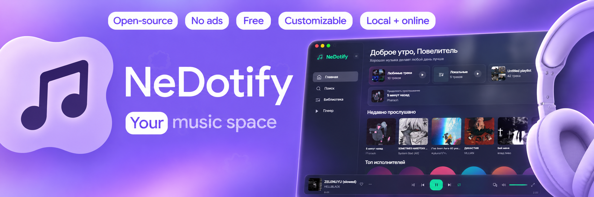
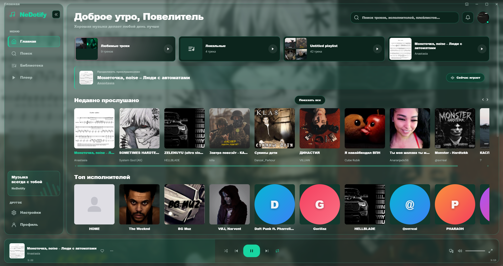
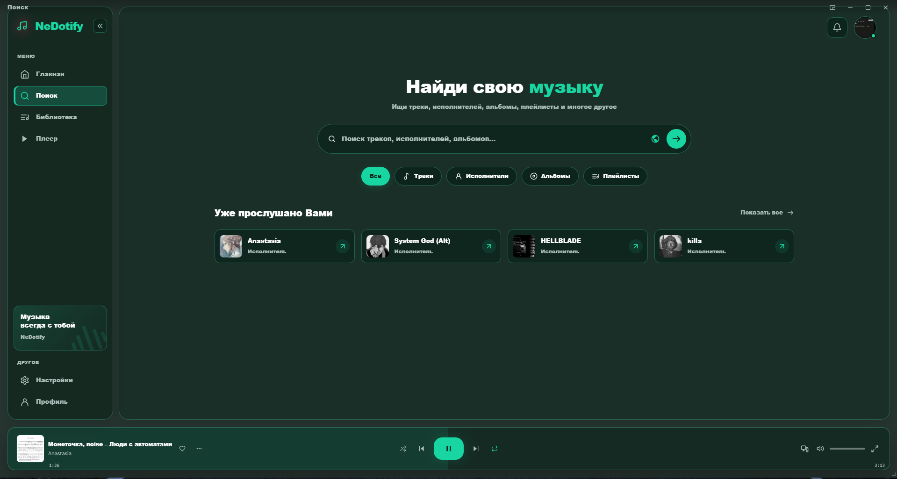
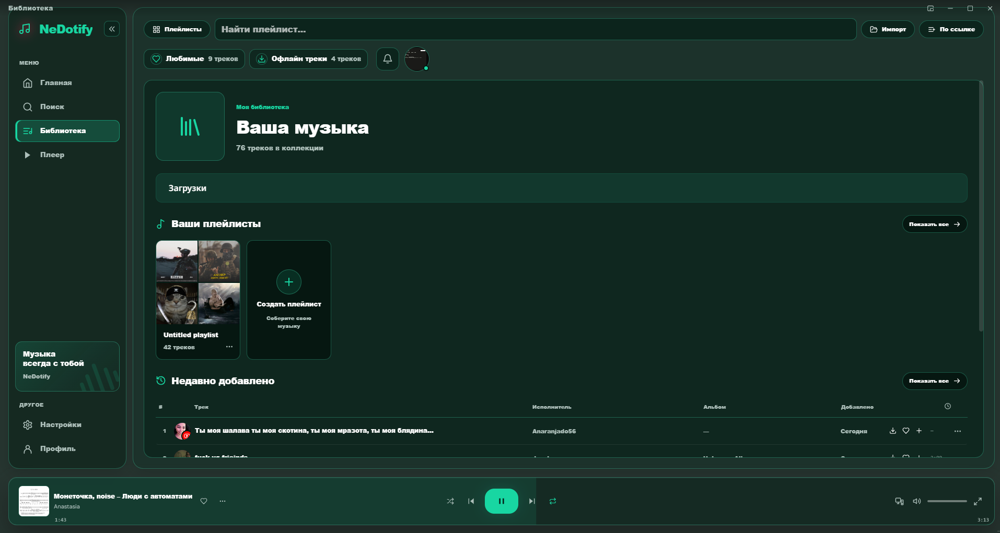
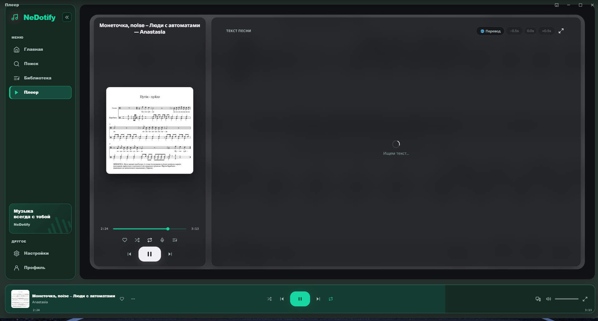
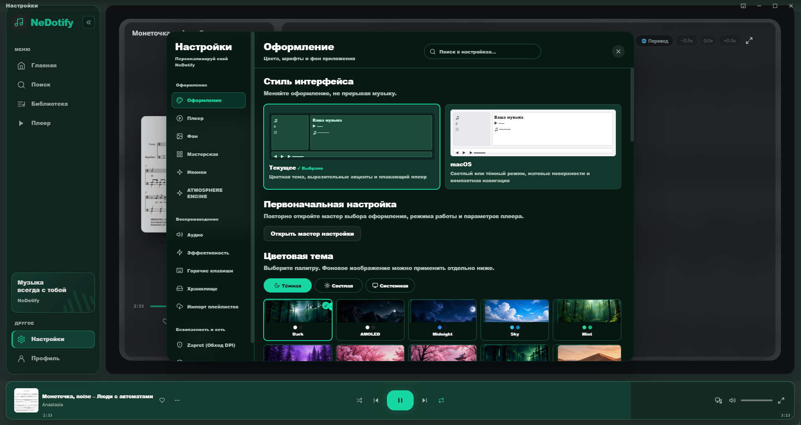
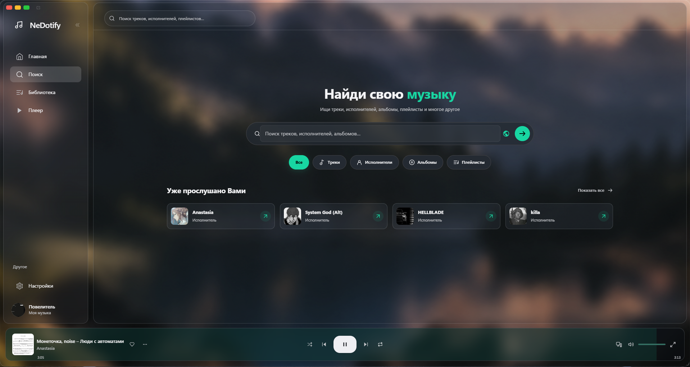
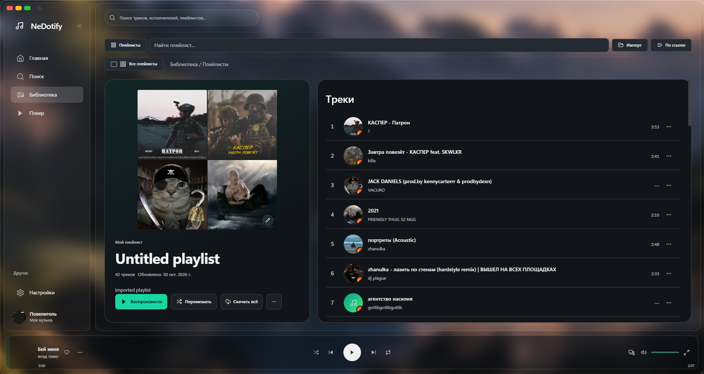
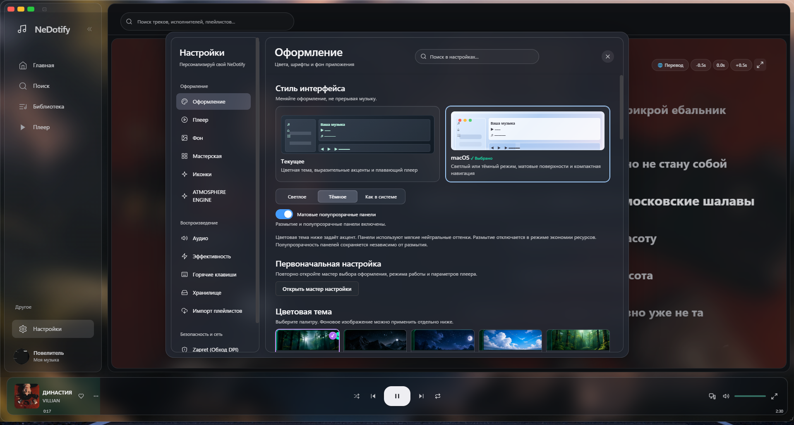

<p align="center"></p>

<h1 align="center">NeDotify</h1>
<p align="center"><b>NeDotify 2.5.6 для Windows 10 / 11</b><br>Локальная библиотека, онлайн-источники, тексты песен и оформление под себя.</p>
<p align="center">
  <a href="https://github.com/PoviceProgrammer/NeDotify/releases/latest"></a>
  <a href="https://github.com/PoviceProgrammer/NeDotify/releases"></a>
</p>
<p align="center"><a href="#возможности">Возможности</a> · <a href="#скриншоты">Интерфейс</a> · <a href="#установка">Установка</a> · <a href="#запуск-из-исходников">Из исходников</a></p>
<p align="center">
  
  
  
  <a href="LICENSE"></a>
  
</p>

## Скриншоты

Два оформления одного Windows-приложения. Переключаются в настройках.

<details open><summary><b>Обычный интерфейс</b></summary>

<table>
<tr><td width="50%"><br><sub>Главная</sub></td><td width="50%"><br><sub>Поиск</sub></td></tr>
<tr><td width="50%"><br><sub>Библиотека</sub></td><td width="50%"><br><sub>Плеер</sub></td></tr>
<tr><td width="50%"><br><sub>Настройки</sub></td><td width="50%"><br><sub>Профиль</sub></td></tr>
</table>
</details>

<details><summary><b>macOS-стиль на Windows</b></summary>

<table>
<tr><td width="50%"><br><sub>Главная</sub></td><td width="50%"><br><sub>Поиск</sub></td></tr>
<tr><td width="50%"><br><sub>Библиотека</sub></td><td width="50%"><br><sub>Плеер</sub></td></tr>
<tr><td width="50%"><br><sub>Настройки</sub></td><td width="50%"><br><sub>Профиль</sub></td></tr>
</table>
</details>

---

## Что нового в 2.5.6

Персональная волна, выбор артистов при первом запуске, исправления воспроизведения, поиска артистов и управления Zapret. [Полный список изменений](CHANGELOG.md).

## Возможности

**Источники**

- Стриминг с YouTube Music и SoundCloud; каталог Apple Music / iTunes с подбором подходящей записи на YouTube. Прямое воспроизведение защищённых потоков Spotify и импорт его плейлистов по ссылке не поддерживаются.
- Офлайн-треки: плейлисты импортируются и качаются на диск
- Чтение тегов из локальных файлов, эквалайзер на 10 полос

**Воспроизведение**

- Тексты песни по строкам, сдвиг синхронизации ±0.5&nbsp;с, перевод
- Визуализатор
- Повтор, перемешивание, перетаскивание треков в очереди
- Мини-плеер поверх других окон
- ⌨ Горячие клавиши — любую можно переназначить

**Интерфейс**

- Темы оформления, можно собрать свою
- Плейлисты: создать и импортировать; экран плейлиста разделяет описание
  и список треков
- Подборки «Для тебя» и ежедневные миксы строятся по истории и предпочтениям;
  состав можно открыть или сразу воспроизвести
- Главная использует обложки из истории прослушивания для фоновой атмосферы
- Пошаговая первоначальная настройка с живым предпросмотром оформления и параметров
- Анимированный переход между обычным окном и мини-плеером
- Discord Rich Presence — статус об играющем треке

---

## Установка

Установщик `.exe` ставит ярлыки на рабочий стол и в меню «Пуск».
Актуальная сборка — **2.5.6**, файл `NeDotify_Setup.exe` на странице релизов:

**[Скачать на GitHub Releases](https://github.com/PoviceProgrammer/NeDotify/releases)**

Для пошагового запуска см. [установку, подключение VPN и воспроизведение первого трека](docs/TUTORIAL_WINDOWS_INSTALL_VPN_PLAYBACK.md).

Собрать самому (имя выходного файла задаёт `OutputBaseFilename` в `installer.iss`):

```powershell
& ".venv_win\Scripts\python.exe" -m pip install -r requirements.txt
& ".venv_win\Scripts\python.exe" -m PyInstaller setup_pyinstaller.spec
iscc installer.iss
```

На выходе — `dist\NeDotify_Setup.exe`.

---

## ‍ Запуск из исходников

```powershell
git clone https://github.com/PoviceProgrammer/NeDotify.git
cd NeDotify

python -m venv .venv_win
& ".venv_win\Scripts\python.exe" -m pip install -r requirements.txt
```

Запуск — `python main.py` из корня репозитория, интерпретатором из `.venv_win`:

```powershell
& ".venv_win\Scripts\python.exe" main.py
```

> Системный `python` не подойдёт — в нём нет `pywebview` и `yt-dlp`.
> Нужен именно интерпретатор из `.venv_win`.

Если приложение уже работает, но окно скрыто, откройте NeDotify через значок
в трее. Крестик полностью закрывает приложение и очищает Discord-статус.
Обычное сворачивание сохраняет воспроизведение музыки.

---

## Тесты

```powershell
& ".venv_win\Scripts\python.exe" -m pytest
& ".venv_win\Scripts\python.exe" -m pytest tests\test_build_and_brand.py -q
```

`pytest.ini` по умолчанию исключает тесты с маркером `network`, которым нужен
реальный доступ к площадкам. Для их отдельного запуска передайте `-m network`.
`run_tests.py` использует ту же конфигурацию pytest.

Инструкции для разработки:

- [Тесты — nedotify-test](.claude/skills/nedotify-test/SKILL.md)
- [Запуск и проверка окна — nedotify-run](.claude/skills/nedotify-run/SKILL.md)
- [Сборка EXE и установщика — nedotify-build](.claude/skills/nedotify-build/SKILL.md)
- [Замеры производительности — nedotify-perf](.claude/skills/nedotify-perf/SKILL.md)

Актуальные описания функций и изменений интерфейса собраны в
[STATUS.md](STATUS.md) и тематических заметках:

- [Рекомендации «Для тебя» и ежедневные миксы](docs/recommendations-for-you-20261102.md)
- [Первоначальная настройка и анимации](docs/riff-onboarding.md)
- [Атмосфера главной и Discord Rich Presence](docs/ATMOSPHERE_AND_DISCORD.md)
- [История функций и проверок библиотеки](docs/FEATURES_2026_10_15.md) — датированный
  архив; некоторые пункты могли быть удалены позднее.

---

## Доступ к онлайн-источникам

Если площадка недоступна в вашей сети, приложение может работать через системный
VPN в TUN-режиме. Явный прокси задаётся в настройках приложения.

<table>
<tr><td>

### TequilaVPN

**VPN для доступа к музыкальным сервисам.**

[Открыть TequilaVPN в Telegram](https://t.me/TequilaVPNbot?start=refugkQUieF)

Реферальная ссылка автора проекта. Сервис предоставляется отдельно от NeDotify.

</td></tr>
</table>

---

## Стек

Python 3.14 · pywebview + WebView2 · SQLite (WAL) · yt-dlp · Vanilla JS

Фронтенд без сборщика и бандлера: правьте `ui/web_new_v2/` и перезапускайте.
Единственный интерфейс **desktop-плеера** — `ui/web_new_v2/`; он включён в
сборку EXE. Выбор других версий удалён.

---

## Лицензия

Проект распространяется по лицензии [MIT](LICENSE).

Уведомления об авторстве и лицензии сторонних компонентов сохранены в [licenses/](licenses/).
